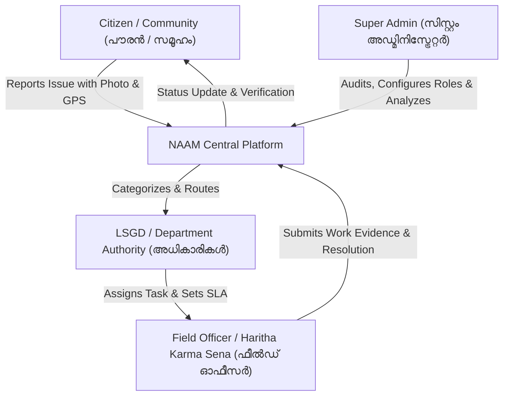

# 00. NAAM (നാം) — Project Overview

## 1. Project Identity
- **Name:** NAAM (നാം)
- **Tagline:** ജനകീയ പരിസ്ഥിതി നിരീക്ഷണവും പരിഹാരവേദിയും (People's Environmental Monitoring and Resolution Platform)
- **Type:** Malayalam-first Environmental Issue Reporting, Monitoring, and Governance Communication Platform
- **Deployment Level:** Advanced Functional MVP for Online Demonstration and Stakeholder Evaluation
- **Primary Target Audience:** Citizens of Kerala, Ward Members, Local Self-Government Institutions (Grama Panchayats, Municipalities, Corporations), Suchitwa Mission, Haritha Karma Sena, Kerala State Pollution Control Board (KSPCB), Irrigation and Water Resources Departments, and Disaster Management Authorities.

---

## 2. Executive Summary
Environmental degradation—including unscientific waste dumping, waterbody pollution, clogged drainage networks, and recurrent flash-flood vulnerabilities—frequently affects communities across Kerala. Despite local governance mechanisms, citizens often lack a transparent, accessible, location-aware, and Malayalam-first digital channel to report ground-level environmental concerns and track their resolution.

**NAAM (നാം)** bridges this gap. It provides a community-centered digital platform where citizens can effortlessly document environmental issues with geo-tagged photographs, precise map locations, and categorized severity indicators. Crucially, complaints are routed to the appropriate local governance bodies and departmental field officers, creating an auditable, transparent lifecycle from initial submission to on-the-ground verification and resolution.

---

## 3. Core Objectives
1. **Empower Grassroots Reporting:** Provide a bilingual (Malayalam-first, English secondary) interface enabling any citizen to report localized environmental hazards in under two minutes.
2. **Transparent Issue Lifecycle:** Replace opaque grievance redressal with a verifiable, multi-stage state machine (`SUBMITTED` → `UNDER_REVIEW` → `ASSIGNED` → `IN_PROGRESS` → `RESOLVED` → `VERIFIED`).
3. **Location-Centric Intelligence:** Utilize interactive geospatial mapping (Leaflet + PostGIS) to visualize environmental hotspots, waste clusters, and vulnerable water channels.
4. **Institutional Accountability:** Provide dedicated portals for Local Self-Government (LSGD) authorities and field officers with role-based assignment, progress updates, and photographic evidence of resolution.
5. **Community Awareness & Early Warnings:** Broadcast official environmental alerts and distinguish them clearly from crowdsourced citizen observations.

---

## 4. Problem Statements Addressed
| Problem Area | Current Challenge | NAAM Solution |
|---|---|---|
| **Waste Dumping** | Illegal dumping along roadsides and vacant plots without quick accountability. | Geo-tagged photo reporting mapped directly to Grama Panchayat/Ward Haritha Karma Sena desks. |
| **Water Pollution** | Contamination of rivers, canals, and wells often goes unnoticed until health hazards arise. | Category-specific reporting with pollution severity indicators and alerts to KSPCB/Health inspectors. |
| **Drainage Blockages** | Pre-monsoon drainage failure leads to localized urban and rural inundation. | Pre-emptive reporting with before-and-after photo evidence tracking for desiltation works. |
| **Delayed Communication** | Citizens have no visibility into which department owns an issue or who is assigned to fix it. | Live status timeline, responsible officer assignment display, and status change audit trails. |
| **Language Barriers** | Most existing digital portals default to English or poorly translated bureaucratic terminology. | Native Malayalam typography, natural vocabulary, and intuitive iconographic navigation. |

---

## 5. Stakeholder Ecosystem & User Personas

- **Community Member (പൗരൻ):** Needs an effortless, non-intimidating mobile interface to snap a picture, tag their location, select a category, and get notified when action is taken.
- **LSGD / Department Officer (അധികാരി):** Needs a desktop-optimized dashboard to triage incoming reports, assess evidence, filter by ward/category, and dispatch work orders to field officers.
- **Field Officer (ഫീൽഡ് ഓഫീസർ):** Needs a high-contrast mobile view to navigate to reported coordinates, conduct inspections, update progress, and upload resolution proof.
- **Super Administrator (അഡ്മിൻ):** Needs system-wide oversight, master data configuration (departments, wards, categories), audit logging, and aggregate analytics.

---

## 6. Scope Boundaries (MVP vs Future)
- **Included in MVP:**
  - Full Malayalam-first UI with instant English toggle.
  - Multi-portal architecture (Citizen, Authority, Field Officer, Super Admin).
  - Robust JWT + Argon2id Role-Based Access Control (RBAC).
  - Complete complaint reporting with photo uploads and Leaflet map pin-dropping.
  - Full complaint status workflow with assignment and evidence uploads.
  - Interactive issue map with category filters and severity markers.
  - Curated sample dataset reflecting real Kerala environmental contexts.
- **Explicitly Out of Scope for MVP:**
  - Direct hardware IoT sensor telemetry ingestion (architecture is prepared for future integration).
  - External SMS gateway integration (in-app notifications and web notifications are utilized).
  - Complex automated AI computer-vision triage (manual officer verification is prioritized).
