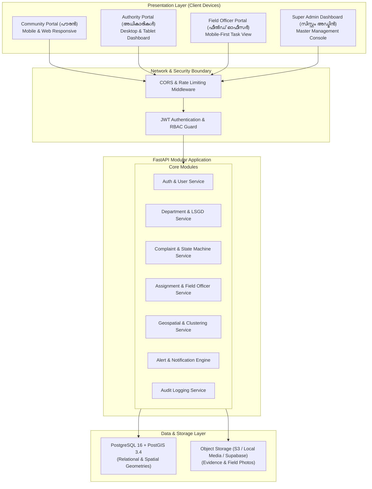
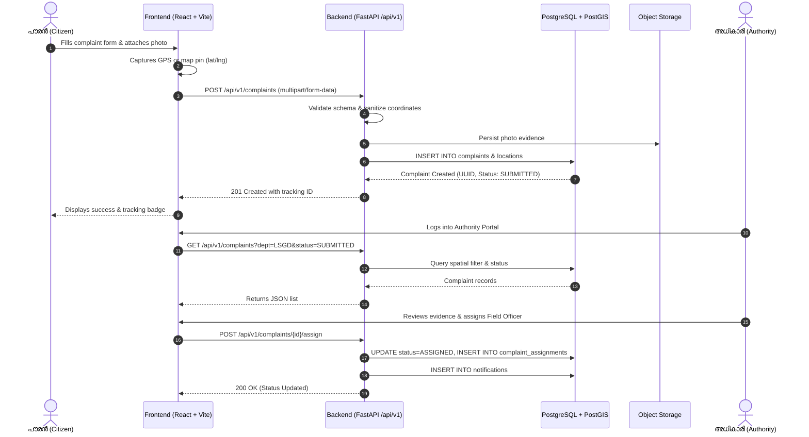

# 04. NAAM (നാം) — System Architecture

## 1. High-Level Architecture Overview
NAAM is engineered as a **Modular Monolith** designed for high developer velocity, clear separation of concerns, rapid MVP demonstration, and frictionless transition to cloud micro-services when scaled across Kerala's 1034 Local Self-Government bodies.

---

## 2. Layered Responsibilities

### 2.1 Presentation Layer (Frontend)
- **Framework:** React 18+ with TypeScript, bundled using Vite.
- **Styling & UI:** Tailwind CSS combined with accessible shadcn/ui primitive components.
- **State Architecture:**
  - **Server State:** TanStack Query (React Query) for caching, optimistic updates, and background re-fetching of complaint feeds.
  - **Client/UI State:** Zustand for localized state (active map bounds, modal triggers, language toggle).
- **Internationalization:** `react-i18next` with JSON-based Malayalam (`ml`) and English (`en`) translation keys.

### 2.2 API & Business Logic Layer (Backend)
- **Framework:** Python 3.12 with FastAPI for asynchronous, high-throughput REST operations.
- **Validation:** Pydantic v2 schemas providing strict compile-time and runtime data validation.
- **Database Abstraction:** SQLAlchemy 2.0 (asyncio-ready ORM) with GeoAlchemy2 for spatial data structures.
- **Security:** Argon2id password hashing via `pwdlib`, PyJWT for cryptographically signed access tokens, and rate-limiting via SlowAPI.

### 2.3 Data Persistence Layer
- **PostgreSQL 16:** Relational storage for users, roles, departments, complaints, and audit logs.
- **PostGIS Extension:** Spatial indexing (`GIST`) on `geometry(Point, 4326)` columns allowing sub-millisecond bounding box searches and radius queries (`ST_DWithin`).
- **File Storage:** Storage abstraction interface allowing local filesystem storage for development and S3/Supabase Storage for cloud deployment.

---

## 3. Communication & Data Flow Sequence

