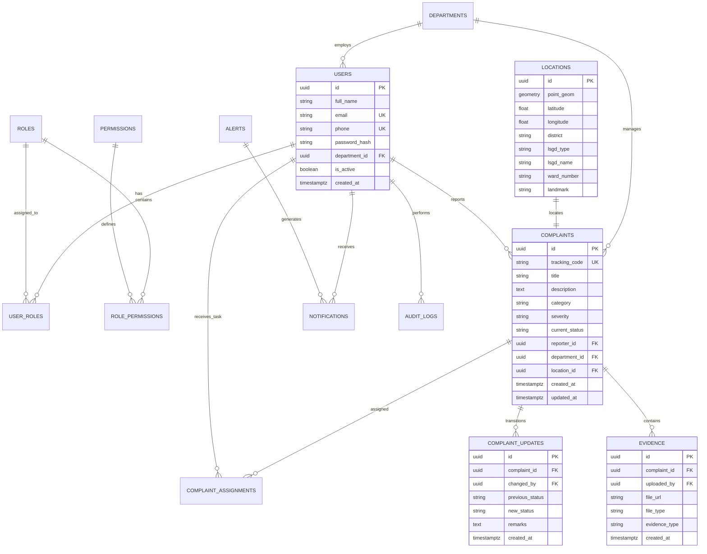

# 07. NAAM (നാം) — Database Architecture & Data Strategy

## 1. Architectural Philosophy
The NAAM database is structured to support high-volume relational transactions, spatial geo-queries, full auditability, and verifiable complaint lifecycle state transitions.

### Key Tenets:
1. **UUID Primary Keys:** All core entities use UUIDv4 / UUIDv7 to eliminate enumerable ID attacks and simplify distributed replication.
2. **PostGIS Geometries:** Spatial locations are stored natively as `geometry(Point, 4326)` allowing indexed distance calculations (`ST_DWithin`) and bounding-box queries.
3. **No Hard Deletes for Operational Records:** Complaints, status logs, and evidence records are immutable. Soft deletes via `is_deleted` and `deleted_at` are enforced where necessary.
4. **Append-Only Audit Trails:** Every status transition and field assignment writes an immutable log to `complaint_updates` and `audit_logs`.
5. **UTC Everywhere:** All timestamps are stored as `TIMESTAMPTZ` (UTC). Timezone conversions to Indian Standard Time (IST, UTC+05:30) occur in the presentation layer.

---

## 2. Entity Relationship Diagram (ERD)

