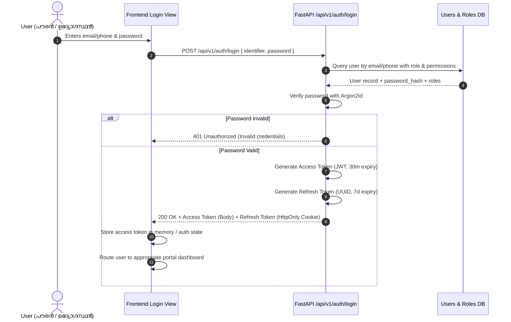

# 09. NAAM (നാം) — Authentication and Role-Based Access Control (RBAC)

## 1. Authentication Architecture
NAAM enforces **centralized backend authentication** using industry-standard security primitives. Although the frontend presents distinct role-specific login views (`/login/community`, `/login/authority`, `/login/officer`, `/login/admin`) to streamline user onboarding and persona-specific assistance, the login page itself conveys **zero inherent authorization**. 

The backend authenticates identity against a unified credential store and cryptographically signs a JSON Web Token (JWT) bearing the user's validated role claims.

---

## 2. Role-Based Access Control (RBAC) Matrix

| Permission Code | Description | Community | Authority | Field Officer | Super Admin |
|---|---|:---:|:---:|:---:|:---:|
| `complaint:create` | Submit new environmental complaint | **YES** | NO | NO | **YES** |
| `complaint:view_public` | View public complaint map & feed | **YES** | **YES** | **YES** | **YES** |
| `complaint:view_assigned`| View complaints assigned to self | NO | NO | **YES** | **YES** |
| `complaint:view_department`| View all department complaints | NO | **YES** | NO | **YES** |
| `complaint:triage` | Change status to UNDER_REVIEW/REJECTED | NO | **YES** | NO | **YES** |
| `complaint:assign` | Assign complaints to Field Officers | NO | **YES** | NO | **YES** |
| `complaint:update_progress`| Post field inspection & notes | NO | NO | **YES** | **YES** |
| `complaint:resolve` | Submit resolution proof & mark RESOLVED | NO | NO | **YES** | **YES** |
| `complaint:verify` | Confirm resolution & mark VERIFIED | **YES** (Own) | **YES** | NO | **YES** |
| `complaint:reopen` | Reopen an unsatisfied resolution | **YES** (Own) | **YES** | NO | **YES** |
| `alert:broadcast` | Publish official environmental alert | NO | **YES** | NO | **YES** |
| `admin:users` | Manage user accounts and roles | NO | NO | NO | **YES** |
| `admin:departments` | Manage departments and wards | NO | NO | NO | **YES** |
| `admin:audit_logs` | View complete security audit trail | NO | NO | NO | **YES** |

---

## 3. Password Hashing Specification
- **Algorithm:** **Argon2id** (via `pwdlib[argon2]`)
- **Memory Cost ($m$):** 65536 KiB (64 MiB)
- **Time Cost ($t$):** 3 iterations
- **Parallelism ($p$):** 4 threads
- Meets OWASP 2024 Password Storage Recommendations.

---

## 4. Token & Session Management
- **Access Token:**
  - Standard JWT signed using `HS256` or `RS256`.
  - Expiry: 15–30 minutes.
  - Claims payload: `sub` (User UUID), `email`, `role`, `exp`, `iat`, `jti`.
- **Refresh Token:**
  - Secure random cryptographic UUID stored in PostgreSQL with token hash.
  - Transmitted via strict `HttpOnly`, `SameSite=Lax`, `Secure` (in production) cookie.
  - Rotated upon every refresh call (Single-use Refresh Token policy).
- **Token Revocation / Logout:**
  - Blacklists refresh token in database on logout.
