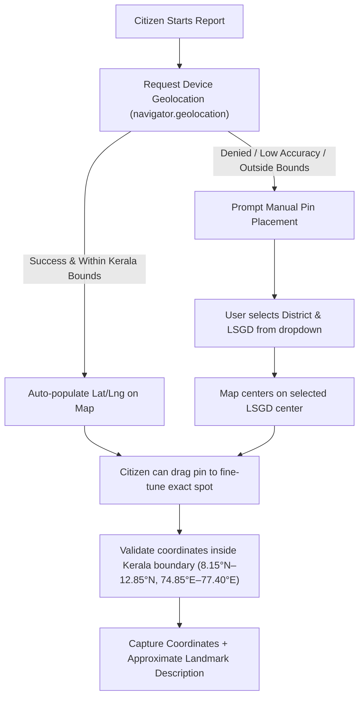

# 13. NAAM (നാം) — Map and Geolocation Architecture

## 1. Mapping Philosophy
Geospatial accuracy is fundamental to NAAM. The platform empowers users to report pinpoint coordinates while handling realistic field conditions in Kerala, such as dense canopy, GPS signal drift, and offline reporting.

---

## 2. Spatial Stack
- **Client Rendering:** Leaflet 1.9 + React-Leaflet with OpenStreetMap and Bhuvan/CartoDB tiles.
- **Spatial Geometry:** `geometry(Point, 4326)` (WGS 84 coordinate reference system).
- **Spatial Engine:** PostGIS 3.4 on PostgreSQL 16.

---

## 3. Location Capture Flow



---

## 4. PostGIS Spatial Query Patterns

### 4.1 Radial Search (Issues within $R$ meters)
```sql
SELECT c.id, c.title, c.category, c.current_status, l.latitude, l.longitude,
       ST_Distance(l.geom::geography, ST_SetSRID(ST_MakePoint(:user_lng, :user_lat), 4326)::geography) AS distance_meters
FROM complaints c
JOIN locations l ON c.location_id = l.id
WHERE ST_DWithin(l.geom::geography, ST_SetSRID(ST_MakePoint(:user_lng, :user_lat), 4326)::geography, :radius_meters)
ORDER BY distance_meters ASC;
```

### 4.2 Viewport Bounding Box Query
```sql
SELECT c.id, c.tracking_code, c.category, c.severity, c.current_status, l.latitude, l.longitude
FROM complaints c
JOIN locations l ON c.location_id = l.id
WHERE l.geom && ST_MakeEnvelope(:min_lng, :min_lat, :max_lng, :max_lat, 4326);
```
