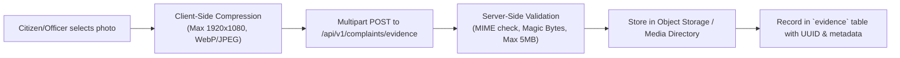

# 14. NAAM (നാം) — Image and File Management Specification

## 1. Evidentiary Image Lifecycle
Photographic evidence is central to environmental complaint verification. NAAM enforces strict integrity, size, and privacy controls.

---

## 2. File Upload Restrictions & Validation
- **Permitted MIME Types:** `image/jpeg`, `image/png`, `image/webp`. Executable files, PDFs, and archives are rejected.
- **Magic Bytes Verification:** Server inspects file header bytes (e.g. `ÿØÿ` for JPEG) to prevent malicious extension spoofing.
- **Maximum File Size:** 5 MB per image (up to 5 images per complaint).
- **Privacy & Sanitization:** EXIF metadata containing camera serial numbers is stripped. GPS coordinates embedded in EXIF are extracted only with user consent to confirm location accuracy.
